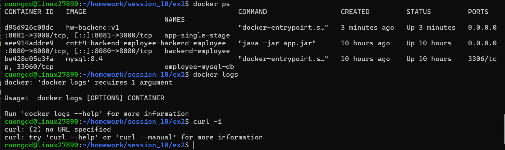

# Bài 2: Đóng gói Web Backend bằng Single-stage Dockerfile

## Mô tả

REST API đơn giản viết bằng Node.js/Express, được đóng gói thành Docker image `hw-backend:v1` bằng Dockerfile single-stage (base image `node:18-alpine`).

## Cấu trúc

```
ex2/
├── Dockerfile
├── .dockerignore
├── package.json
├── server.js
└── README.md
```

## Giải thích Dockerfile

|Chỉ thị|Ý nghĩa|
|-|-|
|`FROM node:18-alpine`|Base image Node.js 18 trên Alpine, dung lượng nhỏ|
|`WORKDIR /app`|Thư mục làm việc trong container|
|`ENV PORT=3000`|Cổng ứng dụng đọc từ biến môi trường|
|`COPY package\*.json ./` + `RUN npm install --omit=dev`|Cài dependency trước để tận dụng cache layer|
|`COPY . .`|Copy mã nguồn vào image|
|`EXPOSE 3000`|Khai báo cổng container lắng nghe|
|`CMD \["node", "server.js"]`|Lệnh chạy dạng exec form, `node` là PID 1 và nhận tín hiệu dừng đúng cách|

## Cách chạy

```bash
# Build image
docker build -t hw-backend:v1 .

# Chạy container, map cổng host 8080 -> container 3000
docker run -d --name app-single-stage -p 8081:3000 hw-backend:v1

# Kiểm tra
docker ps
docker logs app-single-stage
curl -i http://localhost:8080/
```

## Kết quả mong đợi

* `docker ps`: container `app-single-stage` có trạng thái `Up`.
* `docker logs`: `Server listening on port 3000`
* `curl -i`: `HTTP/1.1 200 OK` và body:

```json
  {"status":"success","message":"Hello from Docker Single-stage!"}
  ```

## Dọn dẹp

```bash
docker stop app-single-stage \&\& docker rm app-single-stage
```

## Ảnh minh chứng



